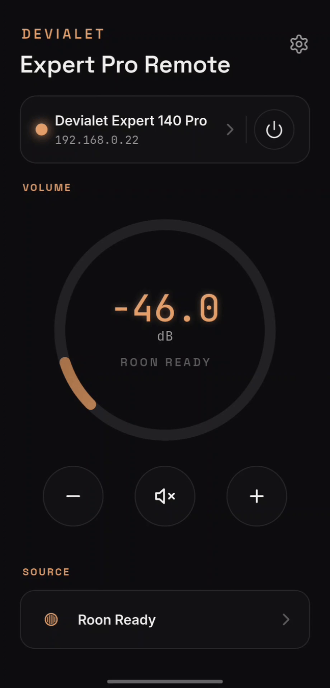
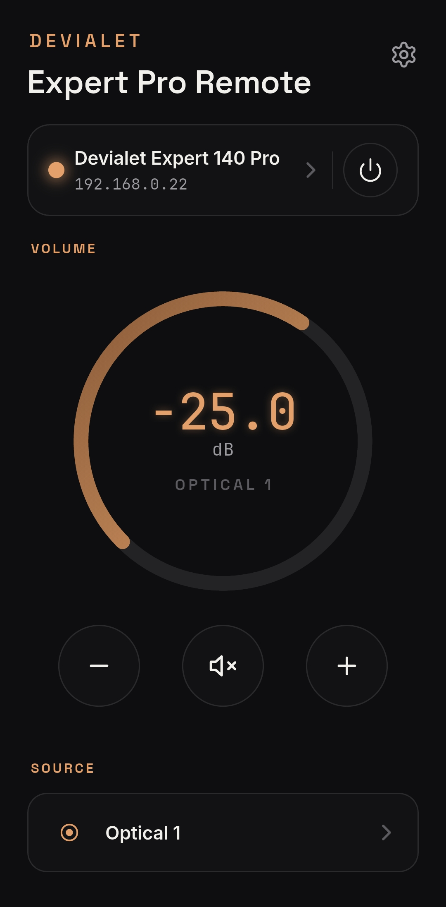
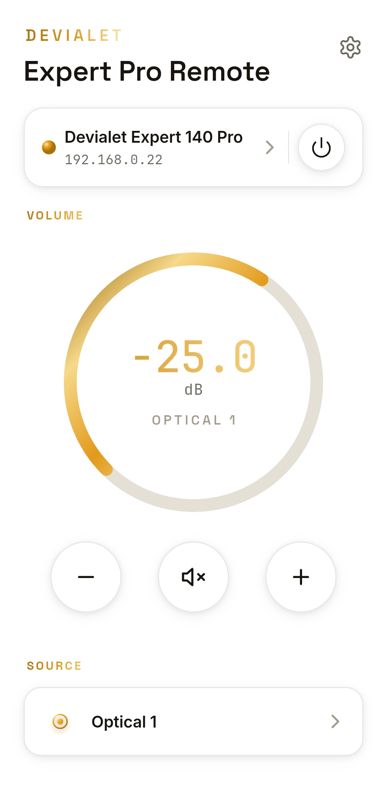
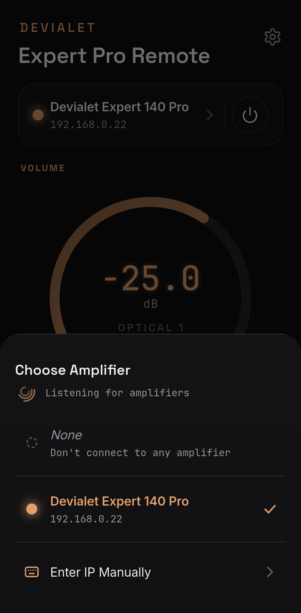
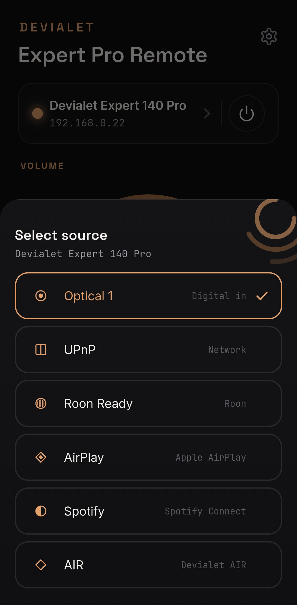
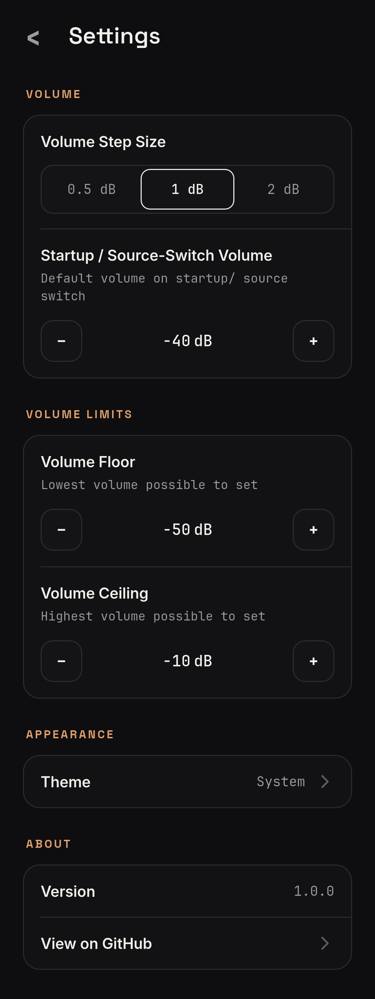

*Drag the dial or tap − / + — the dB readout follows the amplifier in real time, including changes made from the physical remote.*

# Devialet Expert Remote — Android

Control your Devialet Expert Pro amplifier from your phone — volume, mute, source, power, all live over UDP on your local network.


## Features

- **Live volume and mute** — drag the dial or tap the round − / + buttons (hold to repeat); the amplifier's own status broadcasts drive what you see, so the app always shows the real level, including changes made from the remote or the front panel. Changing the volume unmutes automatically.
- **Source switching** — pick any of the amplifier's inputs from the source sheet; the names come straight from the amp, and the configured startup volume is applied after every switch.
- **Power on and off** from the amp card, with a distinct *Booting* state while the amplifier starts up, the startup volume applied once it confirms On, and every other control dimmed until it does.
- **Multi-amp aware** — every Expert Pro broadcasting on your network is discovered automatically and named by model over mDNS; amps that go quiet stay listed as *Not responding*. No broadcast reaching you? Enter the amp's IP by hand.
- **Remembers your amp** — the selected amplifier is reconnected on its own after a restart or a network drop, no tap needed.
- **Configurable limits** — a dial floor, an absolute volume ceiling the amplifier is never sent past, a startup volume, and a step size of 0.5, 1 or 2 dB. Settings take effect immediately and persist.
- **Dark and light themes** — pick Dark or Light, or follow the system.

## Screenshots

### Control

<p align="center">
  
  &nbsp;
  
</p>

*The Control screen, top to bottom: the amp card (name, model, IP, a status dot, and power), the volume dial with the dB readout, the − / mute / + row, and the active source (tap to switch inputs). Dark theme on the left, light on the right.*

### Amplifier and source sheets

<p align="center">
  
  &nbsp;
  
</p>

*Tap the amp card to pick an amplifier — or enter an IP manually — and tap the source row to switch inputs.*

### Settings

<p align="center">
  
</p>

*Every setting on one page: floor, ceiling and startup volume (tap to step, hold to repeat, or tap the value to type), step size, theme, and About. Open it from the gear in the header.*

## Status

Developed and tested on a Samsung Galaxy S25. Planned work lives in [`TODO.md`](TODO.md).

## Requirements

| Component | Version / notes |
|---|---|
| Flutter SDK | 3.47 or later (stable channel), Dart `^3.13.0` |
| Android | Flutter's default minimum SDK |
| Devialet Expert Pro | on the same LAN as the phone; developed and tested on an Expert 140 Pro, protocol shared across the Expert / Expert Pro line |

## Build and install

There are no store releases yet — build from source. With the phone connected (USB or wireless ADB):

```
git clone https://github.com/ekmanch/devialet-expert-remote-app.git
```

```
cd devialet-expert-remote-app
```

```
flutter pub get
```

```
flutter build apk --release
```

```
flutter install --release
```

To remove the app, uninstall it the usual way; its settings and remembered amplifier go with it.

## Development

Run the tests:

```
flutter test
```

[`CLAUDE.md`](CLAUDE.md) has the Android Studio run-configuration setup, the project conventions and the PR review checklist.

## Try before installing

Design mockups for the Control screen, the sheets and Settings live under [`design/mockups/`](design/mockups/) as standalone HTML files. Open the Android one in a browser to click through the interactions before building anything. It is the reference the app is built to match.

## Architecture

Three layers, pure Flutter and Dart:

- **Networking** (`lib/networking/`) — pure Dart, no Flutter imports: packet building and parsing, CRC, volume encoding, the UDP transport and mDNS model-name lookup. Covered by byte-exact golden-vector tests.
- **Domain** (`lib/domain/`) — a single Riverpod state owner for the live amp state. It keeps optimistic and confirmed values apart, masks late pre-change broadcasts for 400 ms after each command, runs the Off / Booting / On power machine, and tracks every amp it has heard. Settings live in one typed object over `shared_preferences`, repaired on load before the UI binds.
- **UI** (`lib/ui/`) — the Control and Settings screens, theme tokens and shared widgets.

A small platform channel (`lib/platform/`) holds the Android multicast lock that lets the app receive the amp's broadcasts. The protocol itself is documented in [`docs/protocol.md`](docs/protocol.md), with live-amp verification reports alongside it in [`docs/`](docs/).

---

<sub>MIT License · Sibling project: the <a href="https://github.com/ekmanch/devialet-expert-remote-kde">KDE Plasma widget</a>. Protocol work builds on the community projects <a href="https://github.com/jprouty/devialet_expert">jprouty/devialet_expert</a> and <a href="https://github.com/gnulabis/devimote">gnulabis/devimote</a>. Not affiliated with Devialet.</sub>